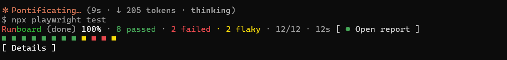

# Runboard

A live Playwright run dashboard above the Claude Code prompt. Ask Claude to run your tests and the
band follows the run as it goes:



- One square per test: green passed, red failed, yellow flaky (passed on retry), magenta
  interrupted (the run stopped in the middle of it), hollow skipped, pulsing blue running, dim not run
  yet.
- Progress, counts, elapsed time and an ETA once 5 tests are done.
- `Stop run` interrupts the run as Ctrl+C does, so the report still covers the tests that ran; once it
  ends, `Open report` opens the HTML report.
- `Details` lists failed and flaky tests with their error and a `Trace` button that opens the trace.
- A run that ends before every test ran (`Stop run`, `--max-failures`, a global timeout) says
  `(stopped)` instead of `(done)`. Its completed results stay; interrupted and never-started tests are
  counted apart from failures (`1 interrupted · 2 not run`) and don't count toward `n/total`, so a
  partial run never looks like a fully evaluated suite.
- Keeps following the run through `/reload-plugins`; clears itself 3 minutes after the run ends.

## Install

In your terminal:

```
claude update
claude plugin marketplace add Dbravi/runboard
claude plugin install runboard@runboard
```

`claude update` matters: older Claude Code versions fail to load the mod (`"session.start" is not an
event`). It is active in the next session you start.

Update to the latest version:

```
claude plugin marketplace update runboard
```

then `/reload-plugins` in a running session.

## Requirements

- **Claude Code 2.1.291 or newer** (`claude update`).
- **The Playwright `list` reporter** in `playwright.config.ts`. Runboard reads its output; with only
  `dot`, `line` or `html` it can't count tests. Playwright uses `list` by default locally and `dot` on CI.
  When the config sets reporters without `list`, Runboard stays off for that run and a toast says so;
  it never changes your config or reporters. With `reporter: 'html'` alone, use
  `reporter: [['list'], ['html']]`.
- **Runs started by Claude.** Runboard sees commands Claude runs, not the ones you type in your own
  terminal. Live updates need a background run (Claude starts long runs that way); a foreground run
  only shows the final result.

## What starts it

- A command containing `playwright test`, e.g. `ENV=local npx playwright test tests/x --project=chromium`.
- `npm run <script>` or `npm test`, when that script in `package.json` runs `playwright test`.
- Ignored: `--list` and `--ui` (they don't run tests), and every other command.

## Good to know

- Ships a `runboard` skill that tells Claude how to start runs so the band works (background, no
  `--reporter`, one run at a time). It loads automatically with the plugin.
- `Stop run` sends SIGINT to the run's process group and falls back to stopping the background task if
  no run process is found. It goes through Claude Code's permission check, so the first press may ask
  for approval.
- **On Windows `Stop run` can't interrupt gently**: there's no SIGINT for another process there. It
  ends the run's own Playwright process tree instead (the `playwright test` under the run's folder,
  found with PowerShell). The tests that finished keep their results and the band says `(stopped)`,
  but Playwright writes no HTML report for that run. TaskStop alone isn't enough on Windows: it ends
  the shell while Playwright keeps going, and every test left fails with a crashed worker.
- `Open report` runs `npx playwright show-report`, passing the html reporter's `outputFolder` from
  `playwright.config` when it sets one (otherwise Playwright's default `playwright-report`).
- `Open report` and `Trace` run in the folder the run ran in: the session's, or where a leading
  `cd <dir> &&` in the command went (`~` and `$HOME` included). If one fails, a toast says why.
- `Open report` appears only when the run wrote an HTML report: its `index.html` is newer than the
  run's start. A run without the html reporter (`--reporter=list`, a config without `html`) gets no
  button. A report folder set only through `PLAYWRIGHT_HTML_OUTPUT_DIR` isn't seen, so it gets none
  either.

## Development

```
claude plugin validate .
claude plugin test .
```
